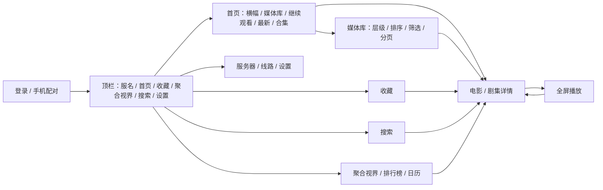

# tvOS 客户端页面与遥控器设计

这是开发中的 tvOS 页面设计正本。用户最新要求与现行 Android TV 的共享手机页面/功能对齐，替代早期最小客户端的产品裁剪。当前电视已更新安装原生对齐阶段版；原生导航、浏览、服务器/线路、设置/私密与播放对齐已部分实现，完整范围尚未验收，网页承接方式待用户决定。Android TV 的现行设计正本不因本文改变。

2026-10-24 当前333条绑定对应源码已通过Mac正式Swift检查与契约回归；同源夹具35图已在tvOS27模拟器运行并对照手机/Android TV/桌面核心页面。本批未安装到电视；模拟器截图不替代真机遥控、真实媒体或最低系统验收。当前实施与剩余差异见文末。

基准为 `TvRoot → PhoneRoot(tv=true) → ui/pages`，不是旧独立 TV 浏览页。逐页来源、差异与平台证据见 [对齐矩阵](../../.trellis/tasks/archive/2026-10/10-18-tvos-minimal-client/research/product-alignment.md)。

## 页面路径

## 视觉与布局

采用 SwiftUI 原生页面，播放器表面通过 UIKit 桥接嵌入。继承现行共享页面的品牌色、卡片/横幅、密度层级和操作语义，具体 token 以当前 Android TV 实际渲染和共享主题为基准，不延续另一套简化版式。遥控焦点和当前选中状态分别表达，不用平台默认控件样式替代整个产品视觉。

当前视觉续作已在源码接入品牌顶栏（服名、文字栏目、搜索/设置图标、选中短线与独立焦点边框），取代系统 TabView 外观。已访问栏目保留实例，未访问栏目不提前发业务请求。首页为独立横幅、横向媒体库入口、16:9 续播卡与 2:3 竖海报轨；轨道标题仅库名，可进入全部内容。卡片标题单行，附年份/集号、已看标记和封面内进度。详情改为背景图渐隐到正文、整行标题，所有已有资料/状态/播放操作保留。这些为源码实现状态，不能替代电视上的视觉与焦点验收。

使用系统 tvOS 字体、动态字号、安全区与焦点导航；不把 Android 的 960×540dp 换算成固定 pt，不增加自定义空间导航算法。布局验收以真实电视观看距离为准。

顶部服名承担服务器管理入口，旁边为首页、收藏、聚合视界及搜索/设置。普通点击服名进入管理；长按/相应遥控操作进入私密，私密时点击退出。媒体库从首页进入；详情和播放隐藏主顶栏。栏目各自保存路径/焦点/滚动；重新选择当前栏目按现行 Android TV 语义恢复入口或原内容。未实现栏目不得用可点占位假装已经对齐。

## 各页

| 页面 | 布局与主操作 | 加载、错误与返回 |
|---|---|---|
| 登录 | 服务器、用户名、安全密码输入与连接；按最终手机伴侣方案增加配对。使用系统键盘，登录中禁止重复提交。 | 失败保留地址/用户名，密码不写日志。首次启动返回交系统；凭据失效后重登，不在未授权时继续出图。 |
| 首页 | 对齐共享首页的横幅、媒体库入口、继续观看、各库最新、合集与已支持插件栏目；卡片菜单沿用现行用户状态操作。 | 区块独立加载/重试；屏外最新轨按需加载。焦点落在轮播时暂停，不因刷新/返回跳动；成功空结果与失败区分。 |
| 媒体库 | 库名与海报网格；排序/筛选及真实层级下钻；触底续页和可聚焦重试。 | 只查直属内容，不按库名推断类型。返回恢复卡片、筛选和滚动；数据变化时落到最近有效项。 |
| 电影详情 | 对齐背景/海报、元信息/日期/简介、收藏/已看、播放/继续与从头、版本/线路/字幕预选、媒体信息、演职员和相似内容；TV 隐藏下载。 | 资料先展示；播放目标实时确认。写入成功刷新相关页，失败保留状态；返回原卡片。 |
| 剧集详情 | 剧资料、季选择行、当前季分集卡片；选集后播放。季和集名称/序号取真实字段。 | 切季不叠路由；播放页按已确认的同季队列和自动下一集开关接续，未知/失败不猜目标。第一页先呈现、后续分页追加，失败保留已加载内容。 |
| 搜索/收藏 | 搜索的当前服/聚合范围、类型/历史与真实结果；收藏分类/排序/分页及取消收藏等菜单。 | 旧请求不覆盖新条件；状态修改后的当前/返回页重验；聚合结果先切到正确服务器。 |
| 聚合视界 | 按服务器分组统计/续播，排行榜/日历快捷入口；保持当前共享页结构，TV 隐藏下载。 | 单服失败与整体失败区分；切服后打开目标。私密不发跨服请求，流影承接方式待决。 |
| 服务器/线路 | 多服务器卡片、添加/编辑/探测/主服/聚合/删除；线路改名/同步/测速/切换。 | 成功持久化后发布新身份；失败保留原选择；删除/登出检查本地结果，不因服务端失败跳过本地移除。 |
| 设置 | 继承共享设置的分组和分节；每项有实际核心或本机偏好读写与生效点。 | Android/引擎/网页/文件系统专属项按已确认平台方案适配，不显示保存成功却无效果的开关。 |
| 播放 | 视频全屏；标题/进度/暂停、选集与同季上下集、版本、音轨/字幕、倍速/画面模式/章节和退出。 | 起播/缓冲/失败明确；切集/版本先过停止屏障。完播卡和自动下一集开关对齐 TV；季末、加载/失败不混淆。实际末集回传详情并刷新。 |

## Siri Remote 行为

| 输入 | 浏览页 | 播放页 |
|---|---|---|
| 方向/滑动 | 交系统移动焦点并滚动到可见区域 | 控制显示时移动焦点；控制隐藏时确认/方向先唤出控制，不意外改变轨道。 |
| 确认 | 触发聚焦项；输入框使用系统键盘 | 控制隐藏时显示控制；显示时触发当前控件。 |
| 播放/暂停键 | 不劫持为页面导航 | 单一控制入口切换引擎状态，立即上报实际位置/暂停态。 |
| 进度条左/右 | 不适用 | 仅进度条聚焦时每次调整 10 秒，限定在有效时长内；确认提交 seek，返回取消预览。未知时长禁用绝对定位并说明。 |
| 返回/Menu | 弹层 → 当前下钻页 → 根页交系统 | 轨道面板 → 收起播放控制 → 停播并回详情；每次只处理一级。 |
| Home/TV | 系统行为 | 系统行为；离开前台由生命周期逻辑暂停、尽力保存。 |
| 长按 / 上下文操作 | 卡片菜单和私密入口按现行 TV 语义映射；不依赖触摸专用手势 | 选集、轨道与更多面板均可遥控到达；临时加速仅在实际遥控事件可可靠区分时适配，不将临时速度落全局偏好。 |

进度条显示控制后不立即抢焦点；聚焦项操作结束恢复原位置。普通控制空闲 5 秒收起，面板、拖动、缓冲或失败状态不自动收起。字幕不是可聚焦控件，不挡住视频或控制的点击/焦点。

## 音轨和字幕

列表来自当前 AetherEngine 会话，使用其真实 TrackInfo.id；不能用 Go/mpv 的 track id 或数组下标替代。当前项显示选中标记；选择成功以引擎发布的实际状态确认，失败保留原选择。详情预选、语言/正则偏好及播放页手选按既有优先级和实际版本身份映射；迟到轨道仍能应用，不再默认清空所有字幕选择。

只有一条音轨时不显示“切换音轨”。远端 HLS bypass 等不可通过选择 API 切换的路径，不给出可点却无效的选择项。字幕始终可关闭；无字幕时提示“无可用字幕”。首轮验收普通文本 cue；无法正确呈现的样式/位图格式说明暂不支持，不把 ASS/PGS 降成未经告知的纯文本。

外挂字幕从核心返回的资源及鉴权信息建立，轨道身份与当前媒体源绑定；切换版本清除旧轨道映射。手选优先于自动选择，不用语言名称猜同语言不同轨。

## 平台差异处理

通用 Go/JS 插件能力、原生声明式页面、网页节点和外部运行组件分别核实。当前 SDK 的 tvOS 无可导入 WebKit，系统文档选择器不可用；流影/网页插件手机承接或电视内替代仍待用户决定。本机目录/备份导入导出也需 tvOS 沙盒与输入来源方案，不把 Android 存储卷路径照搬。所有差异进入对齐矩阵和验收，不因未知而整体删除功能。

## 焦点、请求与生命周期

页面返回记忆由路由条目持有，按账号/条目 ID 隔离。异步加载补齐不会主动抢走焦点；面板关闭回到打开面板的控件。

路由离开、账号变更、切季和新一轮请求会使旧请求失效；即使旧结果返回也不能写入新页面。播放退出及账号变更先结束当前播放会话，再建立新会话。

进入后台暂停视频并读取实际位置，立即尽力回报，不假设系统给无限后台时间。前台回来保留可操作页面；重新确认会话有效后，由用户按播放继续，不自动播放声音。

## 电视与手机照片对照补充（2026-10-18）

用户实拍确认此前首页顶栏与横幅分离、双重左右留白、海报偏小，且顶栏仍出现系统白色焦点板。本轮实现目标：背景延伸到顶栏后方，顶栏浮于顶部渐变上；首页只保留一层内容侧边距，背景铺满屏幕。横幅高650点，续播横卡400×225，竖海报250×375，网格最小列宽随海报同步。当前数值为电视实拍反馈后的调整起点，不能用静态比例代替最终真机验收。

顶栏按钮采用自绘 ButtonStyle，选中栏目短线与遥控焦点轻底色/缩放分开；共用卡片焦点在首页、收藏、媒体库与分集页一致。上轮仅 plain + focusEffectDisabled 未消除实拍白底，后续不可将修饰符存在当作问题已解决。

卡片右下分别呈现普通评分和豆瓣评分，来源不混用；缺失/越界隐藏。右上显示明确统计的未看集数或已看勾，未知整剧统计不能推断完成。续播卡左下显示有效剩余时间，未开始/已完成时使用总时长。当前尚未验收横幅完整轮播/缓存候选及所有其它产品差异。

## 整体视觉续作（2026-10-19）

- 首页、详情正文统一64点侧边距；详情背景忽略容器安全区并隐藏系统导航栏，避免系统留白叠加。头图460点、标题44点；评分/豆瓣/日期/时长、标签、播放、状态操作、媒体信息依次呈现。简介可展开，季集在演员前；标签/字幕预选46点，主操作72点。
- 媒体库316×178，栏目标题30点配竖条；卡片焦点2点浅描边、1.025缩放，顶栏焦点不放大。设置使用单列分组面板、同主题行和开关，危险操作保留红色。首页无候选时收为顶栏空间。
- check-tvos-visual.sh为独立模拟器测试宿主，使用正式页面、合成命令/渐变图片，自动卸载。已人工查看首页、详情、深浅设置四张1920×1080图；设置走正式ProductRoot顶栏。脚本成功只表示截图完成，不是自动视觉/焦点验收。
- 最终check-tvos-ui通过：全正式源码warnings-as-errors类型检查、固定依赖、324条命令对账、Swift CoreClient/DTO/request回归。独立只读复核无确认阻断；指出截图脚本不能判断错误页，本轮人工逐图检查补充。
- 临时宿主改UIScene生命周期后在tvOS27模拟器成功运行；模拟器编译存在sysroot兼容警告。不生成或安装正式客户端；未验真实海报裁切、真机焦点/滚动/播放与tvOS18运行兼容。任务保持in_progress。
- 有效截图留在忽略目录.toolchain/tvos-visual-check/rendered，失败尝试清理，本轮启动的模拟器关闭。

## 全页面视觉收尾（2026-10-19）

- 对照入口为 Android `MainActivity → TvRoot → PhoneRoot(tv=true) → MainShell/NavHost → ui/pages`；旧 `tv/*Page.kt` 不是正式浏览基准。不直接用 Android dp 与 Swift pt 数值判断最终观感。
- 搜索使用横向范围/类型/历史选项和海报结果；收藏根页按库横轨，全部入口进入分类网格，缺库归属按类型回退。聚合按服务器面板显示统计、续播封面与评分。服务器、线路、人物、合集、排行榜、日历、屏蔽页统一内容边距、标题层级和焦点样式。
- 所有设置分节使用同主题面板；筛选、版本和设置枚举使用紧凑选择入口与弹层列表。输入入口使用同主题行，打开系统键盘面板；取消不写回，完成才写父绑定，原保存按钮负责提交核心，搜索提交另执行搜索。密码入口不显示内容。
- 播放控制沿用正式 PlayerView，底部透明至黑色渐变覆盖安全区，控制保留64点左右边距；字幕、标题、进度与按钮分层。选集区标题复用30点栏目组件。
- 聚合/跨服搜索封面使用核心返回的生效线路。图片内存缓存键包含服务器、条目、类型和尺寸；空跨服线路不回退当前服务器，身份变化取消请求并清缓存。业务展示缓存仍由 Go 管理。
- 渲染宿主覆盖23个页面状态及详情、剧集、播放设置下半页；使用合成封面与数据，正式 PlayerView 配合合成视频表面。模拟器截图仅验证布局，不代表真实媒体、输入键盘、遥控焦点或滚动体验通过。真机测试依用户安排后置。

## 分模块对齐续作（2026-10-21，源码待验证）

- 首页 Logo/年份/类型、按视口计算的 Hero、多段纵向暗化、可打开详情的背景和五秒进度条；聚焦 Hero 时暂停轮播。缓存无 Logo、最终资料有 Logo 时按字段变化重跑加载。最新轨使用占位并隐藏成功空轨，缺图显示对应文字。
- 媒体库增加已加载数量、集中筛选面板、评分下限、条件单独清除与空态重置；搜索将分集放入横轨。
- 详情的版本/音轨/字幕选项移到主操作之前，增加视频摘要、可聚焦媒体流卡、分集剧名返回与 SxEy 标题；季内分集横向排列并逐页呈现，演员改为圆头像。人物页增加展开简介、电影/剧集分类与按核心游标分页，合集标题显示数量。
- 榜单使用真正第一至第三名的封面领奖台、后续带图列表及累计加载；日历提供日本时区今日/日期/数量与按明确时间分组的海报时间轴。
- 设置增加本机四色外观，通用倍速/跳过和预取选项即时保存、失败回滚。服务器卡补图标/备注/连通/主服及当前标记，线路补 URL 与生效状态，登录补名称与测试连接。
- 播放器使用左上标题/规格/字幕说明、底部时间与两组操作、右侧面板；面板打开聚焦当前项，关闭返回原控件。补手动跳片头/片尾、真实缓冲/章节/区间及可用章节图片预览、下一集封面倒计时；字幕按控制区实际高度避让。详情音轨预选按实际版本映射真实引擎轨道 ID，歧义时提示并等待，允许手动选择。
- 续作已补：外观加载动画选择/预览，六份 Lottie JSON 与 Android 同源，0 为系统样式，4 随主题染色；本机持久偏好，后台、隐藏栏目、离页暂停，减少动态时取中间帧。语言在输入完成后保存，字幕/主进度服/跨服续播/媒体缓存容量即时保存并失败回滚；正则仍按核心整组校验后保存，不拆成逐字段提交。
- 详情媒体源展示安全路径，远程 URL 去凭据/query/fragment；季集区按继续观看、季封面排列，分集显示 SxEy/当前集/待播放和已看摘要，跨季定位只使用当前列表内的目标。首页 Series 主播放与 Android 共用实时 Go `emby.seriesPlaybackTarget`，不由前端展示缓存决定目标；全已看回首集，成功空季才回退剧 ID，失败不猜。
- 海报比例、留白、焦点和页面滚动仍需要同数据双端渲染及真机复验。
- 此处为2026-10-21源码阶段记录；2026-10-24的正式Swift门禁与同源渲染已完成，见后节。未生成正式包、更新电视、提交或推送本次续作。

## 同源视觉运行与修复（2026-10-24）

- 使用tools/visual-fixtures同源资料、图片及播放静帧，核心六页深浅主题配对，另保留其它页面、下半页及片头跳过/字幕样本，共35图。测试宿主适配传输字段，不放宽正式DTO。
- 首页白字保持暗遮罩，最后8%过渡到当前主题底色；详情仍用主题色渐变与主题文字。顶栏文字/焦点区域保持主题底色覆盖，末端再透明，不将浅色首页整体洗白。
- Lottie4.5.1主题染色只注册受支持的Color属性；桥接接受父布局48×48尺寸，不使用素材固有尺寸或单纯裁剪。加载预览已在运行中检出旧断言和溢出，并随修复通过。
- 播放器截图从正式RootView.fullScreenCover呈现，保留深色播放控件；外层浅色直挂测试曾制造黑字假象，修正测试路径而非改动正常产品行为。
- 已人工对照核心六页深浅、详情/剧集下半页与补充页；保留电视实拍确定的海报刻度、平台输入与密度，不以dp/pt直接换算。未批准golden，tvOS尚无逐像素重复确定性门禁；真实焦点/滚动、实际媒体与tvOS18仍待验收。
